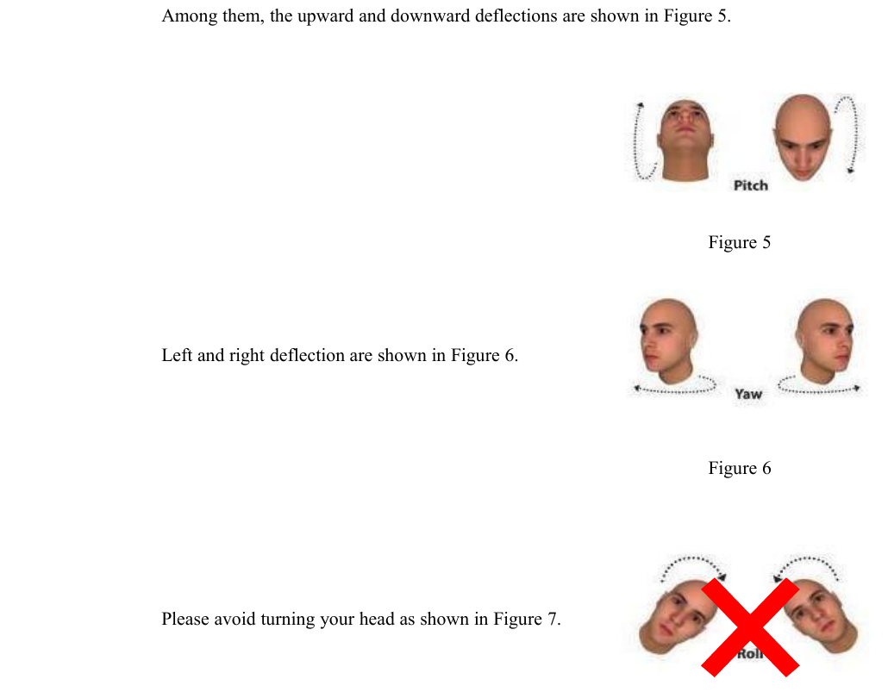

# ESPHome component for the GROW FP002 facial / palm-vein recognition module

An unofficial [ESPHome](https://esphome.io/) external component for the
**GROW FP002** "Facial and Palm Vein Recognition Module" (Hangzhou Grow
Technology Co., Ltd, sold on AliExpress/AliExpress-adjacent stores as a
"UART facial recognition module with palm vein function"). It talks to the
module over its native UART protocol (obtained directly from the
manufacturer's User Manual, V1.01), so no camera streaming, no cloud, no
extra microcontroller-side ML - the module does the recognition itself and
just reports the result over serial.

Built and documented with help from Claude (Anthropic), based on the
official GROW FP002 UART protocol manual.

## Why

There's no "face recognition sensor" story in ESPHome's built-in component
list, and this specific module (cheap, UART, does the recognition on-board)
isn't supported anywhere I could find. This component wires it up as a
normal ESPHome device: sensors/binary_sensors/automation triggers for
recognition events, plus the ability to enroll and delete users straight
from Home Assistant.

**Status: works against the documented protocol and passes ESPHome's config
validation / code generation, but I don't have exhaustive hands-on hours on
real hardware yet.** Framing, checksum and field offsets are transcribed
carefully from the manual - see "Known unknowns" below for the one spot
that's genuinely ambiguous in the manual itself. Feedback / test reports
very welcome, that's the point of this thread.

## What it does

- Parses the module's binary UART protocol (sync word `EF AA`, MsgID, size,
  data, XOR checksum).
- Continuously re-issues a "verify" command in the background
  (`auto_verify`, on by default) so recognition just runs, no polling logic
  needed on your end.
- On a match: a `binary_sensor` (face recognized true/false), a
  `text_sensor` with the recognized user's name, a `sensor` with their
  numeric id, plus `on_face_recognized` / `on_face_rejected` automation
  triggers - wire these to a relay/lock, a notification, whatever you need.
- **Enroll / delete users directly from Home Assistant**, no companion app,
  no vendor Windows tool required, no Developer Tools/Actions either: it's a
  handful of regular entities (a text box, some toggles, buttons) that show
  up on the device itself under **Settings -> Devices & Services -> ESPHome**,
  right alongside its other sensors. Optional native HA services
  (`esphome.<device>_add_user`, `..._delete_user`, `..._delete_all_users`)
  are also there if you'd rather drive this from an automation/script.
- A `registered_user_ids` / `registered_user_count` sensor pair, auto
  refreshed after boot and after every enroll/delete, so you can actually
  see which id to delete.

Enrollment defaults to the module's **interactive 5-direction enroll**
(`MID_ENROLL`: center, right, left, down, up) rather than a single photo, for
better recognition accuracy. Since there's no screen to show "turn left /
turn right" prompts, the module's own status LED is used as the feedback
channel instead: it blinks **green once per captured direction** and
**green 3x** on completion, or **red 2x** on failure - wire `on_enroll_success`
/ `on_enroll_failed` to whatever notification you want in Home Assistant, and
have the person slowly turn their head and pause after each blink. Pass
`quick: true` to the `add_user` service (or `quick=true` to `enroll_user()`)
for the old one-photo enroll instead - faster, but likely less robust.
Palm-vein users always use the one-photo command, since the module has no
interactive mode for palm vein.

## Hardware

- The module itself: search AliExpress for "FP002 facial recognition
  module" / "GROW FP002" (~€15-20 at the time of writing). Comes with a
  6-pin JST/MX1.25 connector.
- Any ESP32 board with a spare UART.

Pinout (module -> ESP32):

| Module pin | Function | Connect to |
|---|---|---|
| 1 VCC | Power, 4.5-12V | External supply (see note below) |
| 2 GND | Ground | Common ground with the ESP32 |
| 3 TXD | Module -> host, TTL | ESP32 RX pin |
| 4 RXD | Host -> module, TTL | ESP32 TX pin |
| 5 IR | IR presence output | Not used by this component yet |
| 6 VCC | IR sensor power, 3-5V | Optional, only if you wire pin 5 |

The module draws up to ~200mA at 4.5-12V, so it will very likely need its
own supply rather than the ESP32's onboard 3.3V regulator - check your
board's regulator headroom before relying on it.

## Installation

Add this repo as an external component in your ESPHome YAML:

```yaml
external_components:
  - source: github://robertrebor/esphome-fp002@v1.0.2
    components: [fp002]
```

(If you forked this under your own account, point the URL at your fork
instead.)

Then see [`example.yaml`](example.yaml) for a complete working configuration,
including the add/delete-user entities described below. The short version:

```yaml
uart:
  id: fp002_uart
  tx_pin: GPIO17
  rx_pin: GPIO16
  baud_rate: 115200

fp002:
  id: fp002_module
  uart_id: fp002_uart
  auto_verify: true
  face_recognized_binary_sensor:
    name: "Face Recognized"
  recognized_user_name:
    name: "Recognized User Name"
  recognized_user_id:
    name: "Recognized User Id"
  registered_user_ids:
    name: "Registered User Ids"
  registered_user_count:
    name: "Registered User Count"
  on_face_recognized:
    - logger.log:
        format: "Recognized user %u (%s)"
        args: ["user_id", "user_name.c_str()"]
```

## Managing users as device entities (recommended)

`example.yaml` adds these as plain entities on the `fp002` device - no
Developer Tools, no calling a service, just fill in/flip/press like any
other entity. They show up under **Settings -> Devices & Services ->
ESPHome -> your device** (and on its device page), right next to
`Registered User Ids`/`Registered User Count`:

- **New User Name** (text) - who you're enrolling.
- **New User Is Admin** / **New User Is Palm Vein** / **New User Quick
  Enroll (single photo)** (switches) - flip on whichever apply, leave the
  rest off. Quick enroll off = the interactive 5-direction enroll (the
  default and the recommended one - see the step-by-step below); palm vein
  always uses single-photo regardless of the quick switch, since the module
  has no interactive mode for it.
- **Enroll New User** (button) - starts it, using whatever's currently set
  in the fields/switches above.
- **Delete User Id** (number) + **Delete User Is Palm Vein** (switch) +
  **Delete User By Id** (button) - delete one user.
- **Delete All Users - Which** (dropdown: all/face only/palm only/general
  only) + **Delete ALL Users** (button) - bulk delete. **Destructive, no
  confirmation dialog** - double-check the dropdown before pressing it.

## Calling it from an automation or script (optional)

If you'd rather trigger add/delete from an automation or script instead of
clicking through entities, `example.yaml` also has an `api: services:`
block exposing the same three actions under **Developer Tools -> Actions**:
`esphome.<device>_add_user` (fields `user_name`, `admin`, `palm_vein`,
`quick`), `esphome.<device>_delete_user` (`user_id`, `palm_vein`), and
`esphome.<device>_delete_all_users` (`type`: 0=all, 1=face, 2=palm,
3=general). It's independent of the entities above - keep it, or delete the
whole block from your YAML if you only want the entities.

## Enrolling a new user, step by step

How to actually move your head for each direction:



Pitch (nod) up/down and yaw (turn) left/right are both fine and expected -
those are exactly the up/down/left/right directions the module asks for.
Rolling/tilting your head sideways (last picture, the one with the red X) is
what to avoid for *every* direction, including center - it throws off the
angle detection regardless of which direction is currently being captured.

1. Position the module at face height, roughly **45-65cm** away (the
   manual's optimal range for face registration - it'll work anywhere from
   20-90cm, but closer to the optimum registers more reliably).
2. In Home Assistant, find the FP002 device (Settings -> Devices &
   Services -> ESPHome, or its device page), type the person's name into
   **New User Name**, flip **New User Is Admin** on if needed, and leave
   **New User Quick Enroll** off for the more accurate interactive enroll.
   Then press **Enroll New User**.
3. Have the person look straight at the module (center/front). The LED
   blinks **green once** as soon as that direction is captured.
4. One direction at a time - this component asks for them in the order
   **center -> right -> left -> down -> up** - have the person slowly turn
   or tilt their head into position (see the picture above) and **hold it
   steady** for a moment. The manual is explicit about this: turn slowly and
   hold the pose, don't snap back to center right away - the module needs a
   moment to read the angle. Wait for the next green blink before moving on
   to the next direction.
5. Only pitch (nod up/down) and yaw (turn left/right) - never roll/tilt the
   head sideways, for any of the 5 directions (the red-X picture above).
6. After the 5th direction (up) is captured, the LED blinks **green 3x** and
   the module assigns the new user their id - `on_enroll_success` fires
   (check the log, or whatever automation you wired it to), and
   `registered_user_ids` refreshes automatically so you can see the new id.
7. If the LED instead blinks **red 2x**, something failed partway through
   (moved too fast, bad lighting, one direction timed out) - check
   `on_enroll_failed` / the log for the reason code. A failed attempt
   doesn't leave anything partially registered, so just call `add_user`
   again from the start.
8. In a hurry, or enrolling a palm instead of a face? Flip **New User Quick
   Enroll** and/or **New User Is Palm Vein** on before pressing **Enroll New
   User** for the old single-photo enroll instead - one frontal photo, no
   multi-step dance, just somewhat less robust for recognition afterwards.
   For a palm, see the next section.

## Enrolling a palm (palm vein), step by step

Palm vein recognition reads the vein pattern under the skin of your palm
with the module's near-infrared camera, so it works at a much shorter
distance than a face. The steps below follow the manufacturer's manual
(sections 1.2 and 5.4.2) - they haven't been verified on real hardware yet,
reports welcome.

1. Have the hand ready about **15-20cm** in front of the module (the
   manual's palm registration distance; recognition later works at
   10-20cm).
2. In Home Assistant, on the FP002 device page, type the person's name into
   **New User Name**, flip **New User Is Palm Vein** on (and **New User Is
   Admin** if needed), then press **Enroll New User**. The **New User Quick
   Enroll** switch doesn't matter here - palm vein is always a single-frame
   enroll, the module has no interactive mode for it.
3. Hold the palm facing the module, fingers naturally spread, directly in
   front of the camera. Move it **slowly back and forth** (towards the module
   and away from it) until the enroll completes. The module waits up to
   `enroll_timeout` seconds (15 by default) for a usable palm.
4. There are no per-direction blinks for a palm: the LED blinks **green 3x**
   on success or **red 2x** on failure, and `on_enroll_success` /
   `on_enroll_failed` fire the same way as for a face.
5. Palm users get ids from **501 to 800** (300 users max), separate from face
   ids (1-500). The new id is in the log and in the `user_id` argument of
   `on_enroll_success`.
6. Turn **New User Is Palm Vein** back off before enrolling a face again.
7. To delete a palm user, set **Delete User Id** to its id (501+), flip
   **Delete User Is Palm Vein** on and press **Delete User By Id** (see
   "Design notes" below for why this is the one spot worth checking with
   `logger: level: VERBOSE`).

Recognition needs no extra setup: the same background verify that matches
faces also matches palms, and the result shows up in the same **Recognized
User Name** / **Recognized User Id** entities.

**Limitation:** **Registered User Ids** / **Registered User Count** currently
list face users only - palm users are stored in the module and recognized
normally, they just don't appear in those two entities.

## Design notes / known unknowns

**Interactive enrollment without a screen.** `MID_ENROLL` (5 directions:
center, right, left, down, up) needs a command *per direction*, each waited
on for its own REPLY - there's no single "just do it" command. Normally
you'd pair that with a live UI showing "turn left / turn right / done".
Since a Home Assistant service call has no such UI, this component instead
drives the module's own status LED (`MID_LED_CONTROL`) as the feedback
channel: green blink after each captured direction, 3 green blinks on
completion, 2 red blinks on failure. The LED writes are fire-and-forget and
non-blocking (`loop()` advances a small blink state machine and only sends
the next direction's command once the blinks for the previous one finish),
so it never blocks the rest of the device. `quick: true` skips all of this
and falls back to the original single-frame `MID_ENROLL_SINGLE` command.

**`MID_DELUSER` command byte vs `user_type` field.** The manual's table for
this command lists two different command bytes - `0x20` for a face user and
`0x80` for a palm-vein user - *and* a `user_type` data byte (0=face,
1=palm) inside the same command's payload, which is redundant on its face.
This component sends both (the matching command byte *and* the `user_type`
byte) to be safe either way the module's firmware actually interprets it.
If deleting a palm-vein user doesn't work for you, this is the first thing
to check with `logger: level: VERBOSE` - reports welcome.

## Protocol reference (for anyone extending this)

- UART: 115200 baud, 8N1, 3.3V logic.
- Frame: `EF AA` + MsgID(1) + Size(2, big-endian) + Data(N) + Checksum(1).
- Checksum = XOR of MsgID, both size bytes, and all data bytes (sync word
  excluded).
- Top-level MsgID is `0x00` for a REPLY (response to a command) or `0x01`
  for a NOTE (unsolicited message - boot-ready, live face state during a
  scan, etc).
- Inside a REPLY, the first data byte is the original command's `mid`, the
  second is the `result` code (`0x00` = success), the rest is
  command-specific.
- `MID_VERIFY` (`0x12`) success payload: user_id (2 bytes, MSB first),
  user_name (32 bytes), admin (1 byte), unlock_status (1 byte).
- `MID_ENROLL_SINGLE` (`0x1D`): admin(1) + user_name(32) + face_direction(1,
  `0x00`=face/`0xFD`=palm) + timeout(1). Reply: user_id(2) + status(1).
- `MID_ENROLL` (`0x13`, interactive): admin(1) + user_name(32) + direction(1,
  one of `0x01` center/`0x02` right/`0x04` left/`0x08` down/`0x10` up) +
  timeout(1) - sent once per direction. Reply: user_id(2, `0xFFFF` while more
  directions are still needed, the real id once all 5 are captured) +
  face_direction(1, cumulative bitmask of directions captured so far).
- `MID_LED_CONTROL` (`0x90`): color(1, `0x00`=green/`0x01`=red/`0x02`=white) +
  switch(1, **inverted**: `0x00`=on/`0x01`=off). No meaningful reply data.
- `MID_DELUSER`: `0x20` (face) or `0x80` (palm), payload user_id(2) +
  user_type(1). No reply data.
- `MID_DELALL` (`0x21`): type(1) + begin_id(2) + end_id(2, only meaningful
  when type=4). No reply data.
- `MID_GET_ALL_USERID` (`0x24`): fmt(1) - this component uses the
  "short"/bitmap format. Reply: count(2) + a bitmap where bit `n` of byte
  `k` (0-indexed) means user id `k*8 + n + 1` is registered.

The full command table (image capture, template upload/download, LED
control, encrypted comms, etc.) is documented in the manufacturer's manual -
worth requesting directly from the seller if you buy the module, they were
responsive when asked.

## License

MIT, see [LICENSE](LICENSE).
